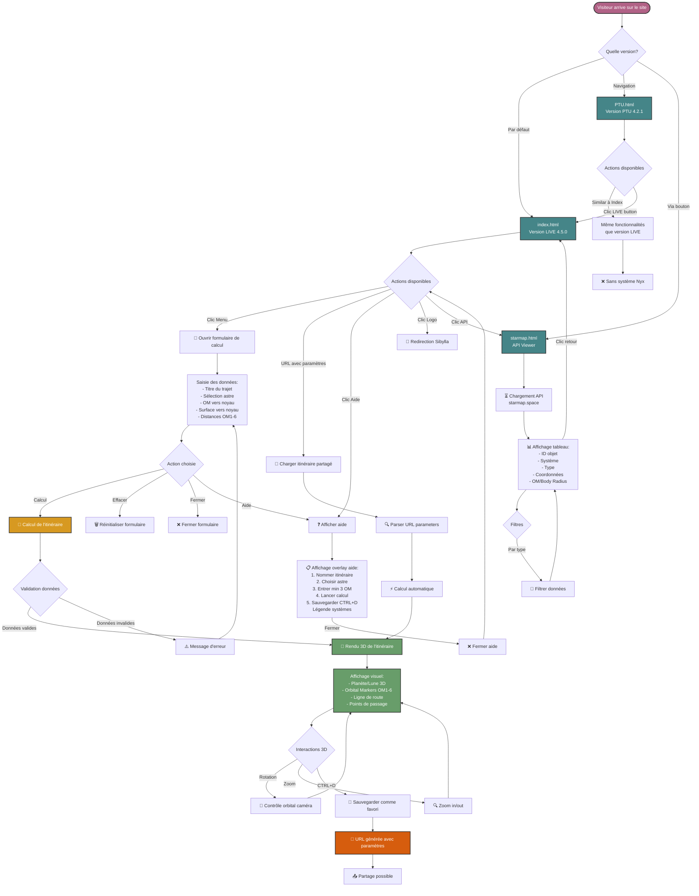
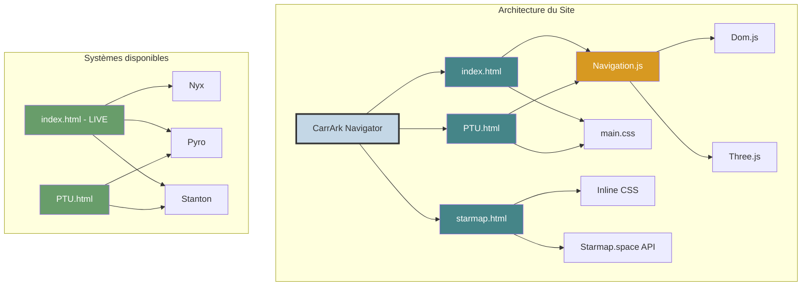
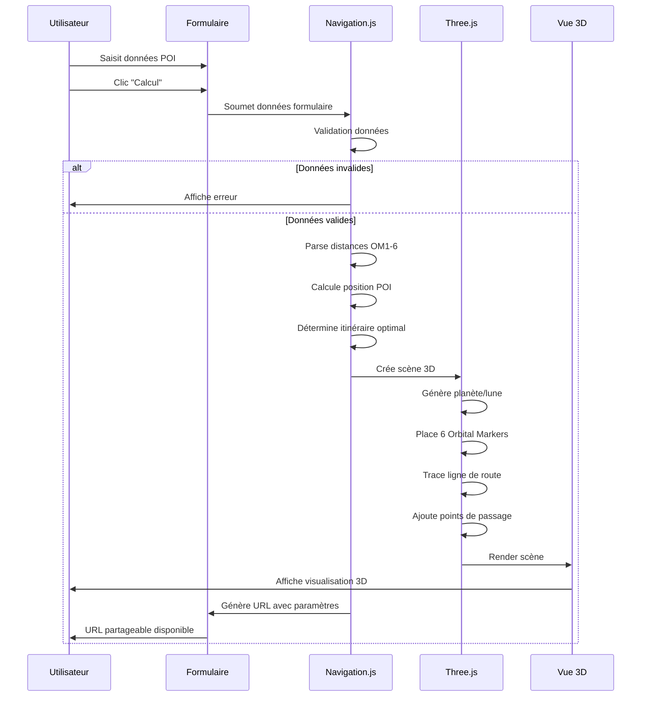
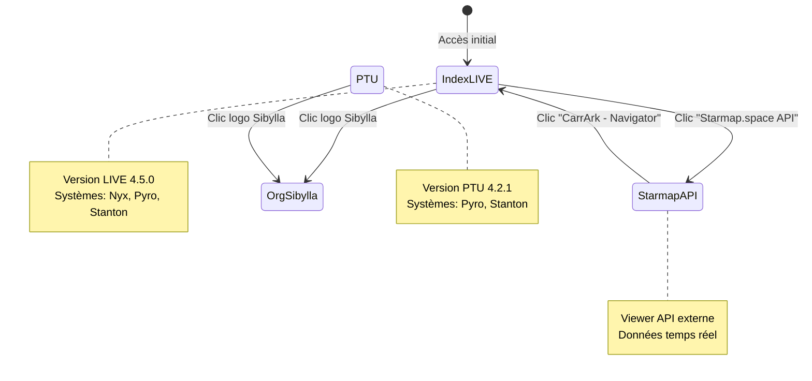
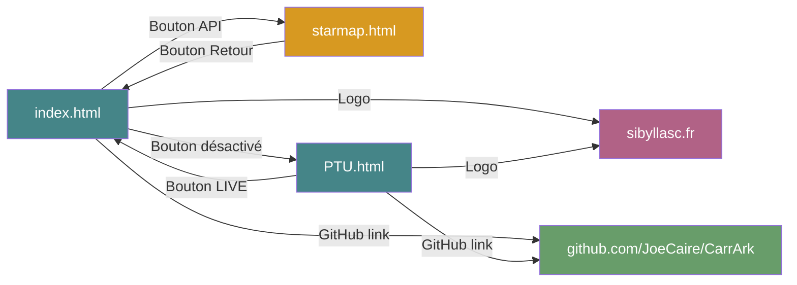

# Diagramme de Flux du Site CarrArk Navigator

Ce document présente le diagramme de flux du site CarrArk Navigator, illustrant la structure, les interactions utilisateur et les flux de navigation.

## Diagramme de Flux Principal

## Structure des Pages

## Flux de Calcul de Navigation

## Flux de Navigation Entre Pages

## Composants et Fonctionnalités

### Pages Principales

| Page | Description | Systèmes | Fonctionnalités |
|------|-------------|----------|-----------------|
| **index.html** | Version LIVE 4.5.0 | Nyx, Pyro, Stanton | Navigation complète, calcul 3D, partage URL |
| **PTU.html** | Version PTU 4.2.1 | Pyro, Stanton | Même fonctionnalités sans Nyx |
| **starmap.html** | API Viewer | N/A | Consultation données API, filtres |

### Fonctionnalités Clés

#### Calcul de Navigation
- **Input**: Distances depuis 3+ Orbital Markers (OM)
- **Process**: Triangulation position POI
- **Output**: Route optimale visualisée en 3D

#### Visualisation 3D (Three.js)
- Rendu planète/lune avec texture
- 6 Orbital Markers positionnés
- Ligne de route avec points de passage
- Contrôles caméra orbital
- Zoom et rotation interactive

#### Partage et Sauvegarde
- Génération URL avec paramètres
- Sauvegarde favoris (CTRL+D)
- Exemples de routes pré-configurées

#### Interface Utilisateur
- Formulaire de saisie données
- Overlay d'aide contextuelle
- Sélection astre par système
- Validation données en temps réel

## Technologies Utilisées

- **Frontend**: HTML5, CSS3, JavaScript ES6+
- **3D**: Three.js (WebGL)
- **Architecture**: Modules ES6
- **API**: Starmap.space REST API
- **Design**: Custom CSS avec thème Star Citizen

## Liens de Navigation

---

## Exemples de Routes Pré-configurées

Le site propose des exemples de routes partagées via URL:

1. **Daymar - Constellation Wreck**
2. **Clio - Starfarer Wreck**
3. **Lyria - Paradise Cove**
4. **Magda - Caterpillar Wreck**

Chaque exemple charge automatiquement les données dans le visualiseur 3D.

---

*Diagramme généré pour CarrArk Navigator v4.5.0*  
*Auteur: Joe-Caire @ Sibylla*  
*License: CC BY 4.0*
