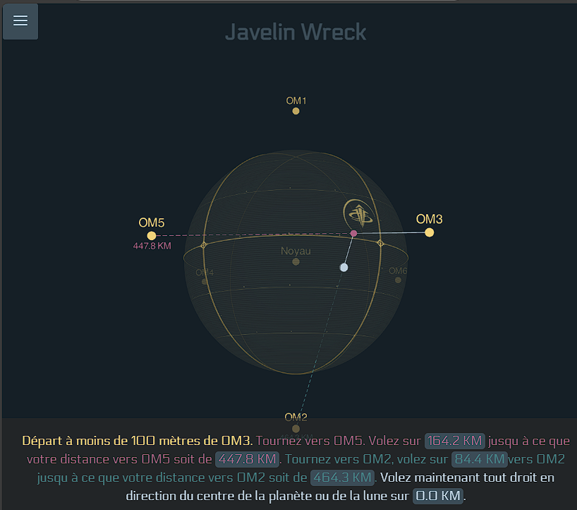
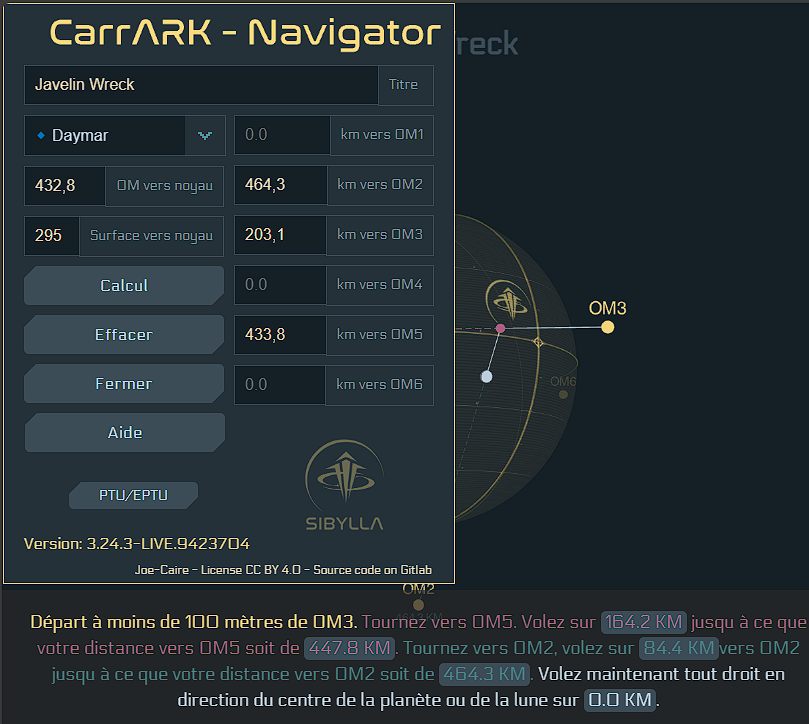

# CarrArk Navigator

Le CarrArk Navigator est un outil open source conçu pour marquer et partager des emplacements en surface dans Star Citizen. Il comble une lacune en attendant l’intégration, dans la Starmap, du stockage et du partage de points d’intérêt.
Chaque planète et lune du jeu dispose de marqueurs orbitaux (OM 1 à 6), géostationnaires et utilisables pour la navigation. Ces marqueurs permettent d’enregistrer une position en calculant la distance par rapport aux trois points OM les plus proches. Bien que cette méthode fonctionne, retrouver son chemin à l’aide de ces distances peut s’avérer fastidieux.
Le CarrArk Navigator est une évolution du Nova Navigator (voir l’historique ci-dessous). Ses améliorations visent à simplifier son utilisation, notamment pour la communauté francophone, grâce à :

- une traduction complète,
- l’ajout d’un menu d’aide,
- une personnalisation des couleurs.
N’hésitez pas à copier, modifier ou héberger votre propre version de cet outil. Étant un site statique, son intégration dans un projet existant devrait être simple.

### Live Examples

- [Daymar - Constellation Wreck](https://carrark.rvsd.fr/?title=Daymar%20-%20Constellation%20Wreck&distance=430&om2=486.5&om3=460.7&om5=168.4&size=295.2)
- [Clio - Starfarer Wreck](https://carrark.rvsd.fr/?title=Clio%20-%20Starfarer%20Wreck&om1=294.9&om3=208.6&om5=397.8&size=240&distance=352.2)
- [Lyria - Paradise Cove](https://carrark.rvsd.fr/?title=Lyria%20-%20Paradise%20Cove&om2=347.8&om3=166.6&om6=316.6&size=223&distance=328.2)
- [Magda - Caterpillar Wreck](https://carrark.rvsd.fr/?title=Magda%20-%20Caterpillar%20Wreck&om1=550.2&om3=516.8&om5=205.3&size=341&distance=494.8)
Create your own at :  https://carrark.rvsd.fr

### Navigation example

### Editor example

## History

En 2019 (environ), [SandovalBurrows](https://robertsspaceindustries.com/citizens/SandovalBurrows), membre de [NOVA Intergalactic](https://novaintergalactic.com/), cherchait à calculer des itinéraires vers des emplacements en surface qu’il pourrait suivre en se dirigeant toujours vers un point visible. En explorant cette idée, il découvrit que [PandaBot](https://robertsspaceindustries.com/citizens/Pandabot) venait de publier un outil similaire : [SC Route Calc](https://pandabotz.github.io/sc-route-calc/). Une excellente trouvaille ! À l’époque, SandovalBurrows travaillait sur le Nova Trade Calculator et n’avait pas le temps de se consacrer à d’autres projets. Il se mit donc à utiliser cet outil pour ses besoins en navigation.
Un Plus tard, une discussion sur Discord avec [LordSkippy](https://robertsspaceindustries.com/citizens/LordSkippy), également séduit par l’idée, le conduisit à découvrir que ce dernier développait VerseGuide. Cet outil, devenu indispensable pour les explorateurs, s’avéra cependant trop complexe pour [SandovalBurrows](https://robertsspaceindustries.com/citizens/SandovalBurrows). Il recherchait simplement un outil compact pour marquer (et éventuellement partager) des emplacements, de préférence utilisable depuis son téléphone.
C’est ainsi qu’il décida de lancer le projet [NOVA Navigator](https://nova-public.gitlab.io/navigator/). À cette période, il expérimentait avec Three.js et choisit de l’utiliser pour la visualisation. Un avantage supplémentaire était de pouvoir exploiter la logique 3D pour simplifier ses calculs mathématiques et déboguer visuellement sa logique. Il mit au point un algorithme robuste, toujours utilisé aujourd’hui après plusieurs années.
Pour rendre cet outil encore plus accessible, notamment à la communauté francophone et plus précisément à notre organisation SIBYLLA, j’ai décidé d’améliorer ce travail remarquable. Mon objectif principal était de le simplifier pour les non-initiés. Les améliorations incluent :

- une traduction en français des instructions,
- l’ajout d’un bouton d’aide,
- l’intégration de Pyro, ses lunes et Nyx,
- une personnalisation des couleurs.

-- [Joe-Caire](https://robertsspaceindustries.com/citizens/Joe-Caire) @ [Sibylla](https://sibyllasc.fr/)

Credit :
Un grand merci à [SandovalBurrows](https://robertsspaceindustries.com/citizens/SandovalBurrows) @ [NOVA Intergalactic](https://novaintergalactic.com/) pour la souche très prometteuse de son travail. 

Et aussi Merci à tous les autres créateurs de contenu du genre :

 - [LordSkippy](https://robertsspaceindustries.com/citizens/LordSkippy) @ [Verseguide](https://verseguide.com/)
 - [Murphy "justMurphy"](https://robertsspaceindustries.com/citizens/Muprhy) @ [Murphy's Navigation Tool](https://docs.google.com/spreadsheets/d/1aGJ0_49ve1NKf0GvSteSt3-a4jSxnj2snHmTDwKTBgs/edit?gid=1238406064#gid=1238406064)
 - [Graupunkt](https://robertsspaceindustries.com/citizens/Graupunkt) @ [Starmap Space](https://starmap.space/)          
 - [xabdiben of Gallog ](https://robertsspaceindustries.com/citizens/xabdiben)
 - [CaptSheppard](https://robertsspaceindustries.com/citizens/CaptSheppard)
 - [Pandabot](https://robertsspaceindustries.com/citizens/Pandabot)
 - [Bo-Fone](https://robertsspaceindustries.com/citizens/Bo-Fone)
 - [Smarty](https://robertsspaceindustries.com/citizens/SmartySG)
 - [Bearded Nugget](https://robertsspaceindustries.com/citizens/bearded_Nugget)
 - [StoicMako](https://robertsspaceindustries.com/citizens/StoicMako)
 - [Thanitorial](https://robertsspaceindustries.com/citizens/Thanitor)
 - [Valalol](https://robertsspaceindustries.com/citizens/Valalol)

## License

CarrArk Navigator de Joe-Caire est sous licence CC BY 4.0. Pour voir une copie de cette licence, visitez http://creativecommons.org/licenses/by/4.0/

Le code est disponible : https://github.com/JoeCaire/CarrArk

Vous êtes libre de :

Partager — copier et redistribuer le matériel sur n’importe quel support ou format à n’importe quelle fin, même commerciale.
Adaptez — remixez, transformez et développez le matériel à toutes fins, même commerciales.

Le concédant ne peut pas révoquer ces libertés tant que vous respectez les termes de la licence.

Selon les conditions suivantes :

Attribution — Vous devez créditer l'œuvre de manière appropriée , fournir un lien vers la licence et indiquer si des modifications ont été apportées . Vous pouvez le faire de toute manière raisonnable, mais pas d'une manière qui suggère que le concédant de licence vous approuve ou approuve votre utilisation.

Aucune restriction supplémentaire — Vous ne pouvez pas appliquer de conditions juridiques ou de mesures technologiques qui restreignent légalement les autres à faire tout ce que la licence autorise.

Avis :
Vous n'êtes pas tenu de respecter la licence pour les éléments du matériel qui sont dans le domaine public ou dont l'utilisation est autorisée par une exception ou une limitation applicable .

Aucune garantie n'est donnée. La licence peut ne pas vous donner toutes les autorisations nécessaires à l'utilisation que vous souhaitez en faire. Par exemple, d'autres droits tels que les droits de publicité, de confidentialité ou les droits moraux peuvent limiter la manière dont vous utilisez le matériel.
